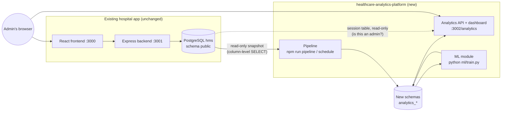
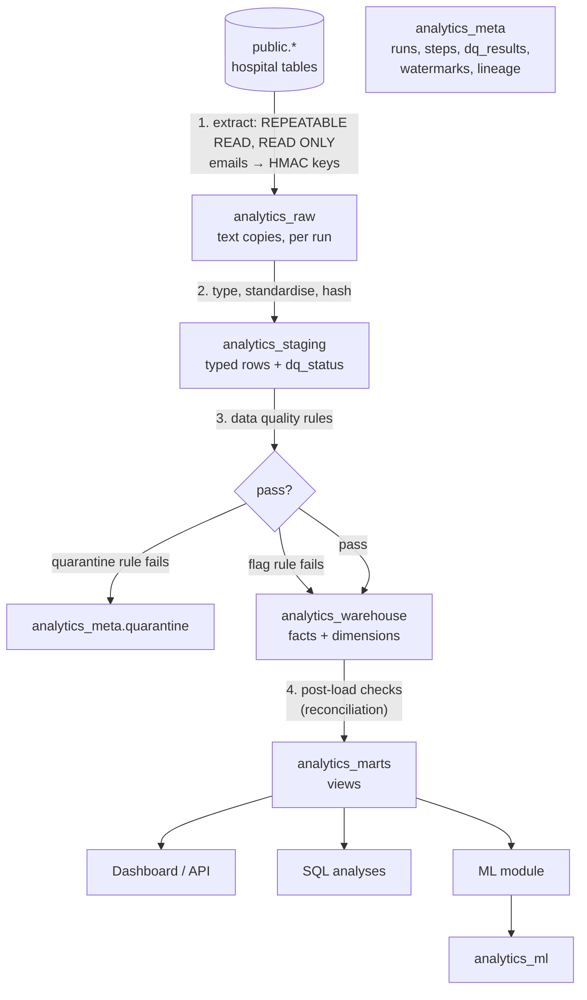
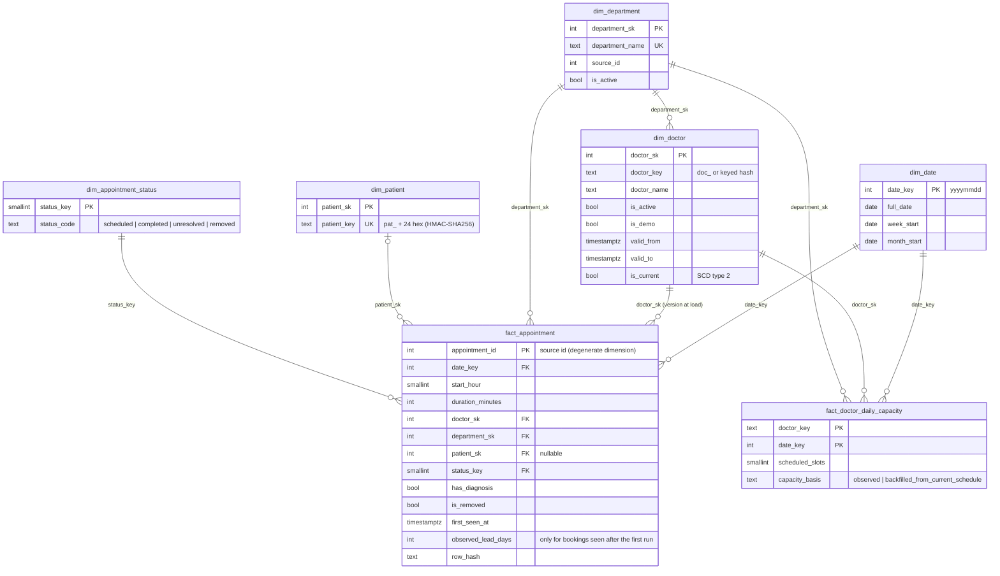

# Architecture

## The big picture



* The platform is its own Node service on its own port, and its own Python module. The hospital frontend and backend are not touched.
* It connects as a separate database role, `hms_analytics`. That role can read only the hospital columns it needs, and can write only to its own schemas.
* The dashboard recognises administrators by verifying the hospital app's signed `hms.sid` session cookie, using the same secret, and reading (never writing) the `session` table. A browser sends cookies for `localhost` to every port, so an administrator signed in on port 3000 is recognised on port 3002.

## Data flow



How a run works (`src/pipeline/pipeline.js`):

1. **Lock.** A PostgreSQL advisory lock makes sure only one run happens at a time. A second run that starts while one is going steps aside.
2. **Schema check.** The pipeline compares the source columns it reads with the baseline it saved on its first run. If a column was removed or changed type, the run is blocked (`unexpected_schema_change`).
3. **Extract.** All reads happen in one `REPEATABLE READ READ ONLY` transaction, so every table comes from the same moment and nothing can be written. Patient and doctor emails become keyed hashes here, before anything is stored.
   * **Incremental mode** first scans a version hash per appointment. The hash covers the row, its patient links and whether it has a diagnosis. The run then fetches only appointments that are new or changed. Deletions are found by comparing ids.
4. **Load, all in one transaction.** This covers raw, staging, data quality, warehouse and post-load checks. If anything fails, the warehouse is left exactly as it was and the run is recorded as `failed`.
5. **Retry.** Temporary errors (lost connection, deadlock, serialisation failure) are retried with exponential backoff. Other errors are not retried.
6. **Record.** The run's status, per-step timings, row counts, rule results and watermarks are stored in `analytics_meta`.

Modes:

| Mode | What it does |
|---|---|
| `full` | Compares every source appointment with the warehouse. Inserts new rows, updates changed ones and marks deleted ones as removed. Idempotent: a second full run changes nothing. |
| `incremental` | Does the same work, but reads only the changed appointments. |
| `validate-only` | Extracts and runs the data quality rules without loading anything. |
| `refresh-only` | Recomputes time-dependent statuses. For example, an appointment whose date has passed moves from "upcoming" to "not completed". |

## Warehouse model (ERD)



**Grain.**

* `fact_appointment` has one row per appointment ever seen. Appointments deleted in the hospital app stay in the fact table with `is_removed = true`, so cancellations can be measured.
* `fact_doctor_daily_capacity` has one row per doctor per day, giving the number of one-hour slots their working hours offered.

**Status.** The hospital app stores only `NotDone` and `Done`. The warehouse derives four statuses from those values plus the date:

| Status | Meaning |
|---|---|
| `scheduled` | NotDone and dated today or later. |
| `completed` | Done. |
| `unresolved` | NotDone and the date has passed. This is the no-show proxy. |
| `removed` | Deleted from the hospital database after the pipeline first saw it. |

**History.**

* `dim_doctor` is a type 2 slowly changing dimension. A change in name, department, active flag, demo flag or fee closes the current version and opens a new one. Facts keep the version that applied when they were first loaded.
* `dim_department` is type 1: it is updated in place.
* Capacity for past days is frozen once written. Days before the pipeline's first run are back-filled from today's schedule and marked as back-filled.

## Database objects created

Only the setup script touches anything outside the new schemas, and it does so only to create one role and grant it read access. Everything else is created by `npm run db:init` as `hms_analytics`.

| Schema | Contents |
|---|---|
| `analytics_meta` | `pipeline_runs`, `run_steps`, `dq_results`, `quarantine`, `watermarks`, `source_schema_baseline`, `dataset_info`, `lineage` |
| `analytics_raw` | Text copies of each extract: appointment, appointment_patient, patient, doctor, department, doctor_schedule, diagnosis_marker |
| `analytics_staging` | Typed and standardised appointment, doctor, department and doctor_schedule |
| `analytics_warehouse` | The star schema above |
| `analytics_marts` | Views: `appointments`, `daily_department_operations`, `weekly_department_demand`, `ml_appointment_features`, `data_freshness` |
| `analytics_ml` | `model_runs`, `demand_forecast`, `segment_profiles` |

## Code map

```
healthcare-analytics-platform/
  src/config.js, db.js, logger.js, pseudonymize.js
  src/pipeline/   source.js (extract), staging.js, quality.js, warehouse.js, pipeline.js, run.js, scheduler.js
  src/server/     server.js, app.js (API), auth.js, filters.js, kpis.js, csv.js
  src/tools/      init-db.js, synthetic.js, profile.js, sql-check.js, verify-baseline.js, generate-docs.js, lineage.js
  public/         index.html, app.js, styles.css (dashboard, no build step)
  sql/setup/      00_roles_and_grants.sql (run once by the database administrator)
  sql/schema/     01_meta.sql … 05_ml.sql (run by npm run db:init)
  sql/analysis/   01 … 14 analytical queries
  ml/             hms_ml/ (data, classifier, forecast, segments, store), train.py, tests/
  test/           unit, pipeline, api, regression tests
  baseline/       file-manifest.json (hashes of the existing project before this was added)
  docs/
```
